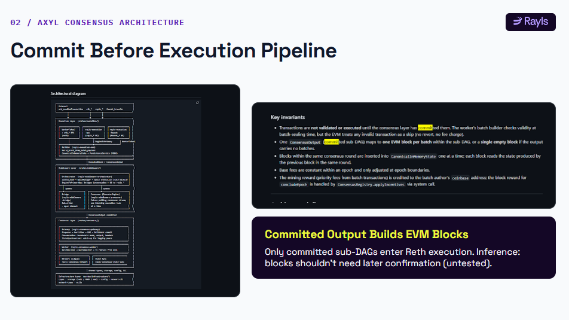
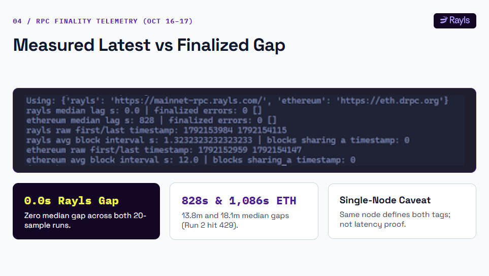
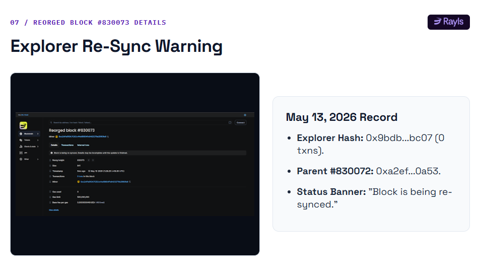
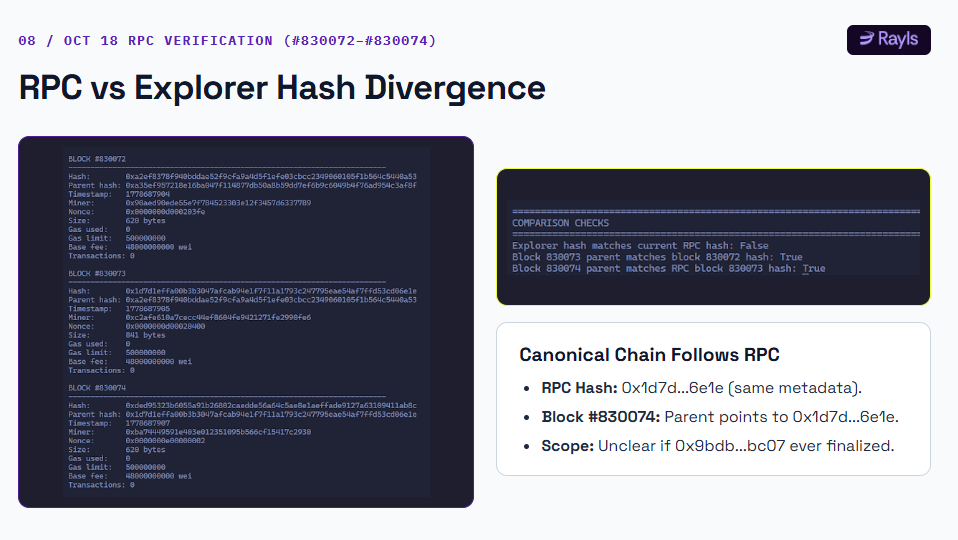

# How Fast Is Rayls Finality? I Checked the RPC Data and Found an Unanswered Question

  
**Research period:** October 16–17, 2026  
**Category:** Blockchain · Consensus · On-chain Research

An exploratory comparison of Rayls and Ethereum RPC responses, and what the data can and cannot tell us about finality.

When a blockchain claims sub-second finality, what can you actually verify from the outside?

That question led me to investigate Rayls Public Chain. Its documentation describes Axyl, the network's consensus algorithm, as delivering deterministic finality in under a second, without chain reorganisations. Those are significant claims, but verifying them independently requires more than reading the documentation or looking at a block explorer.

I ran a small RPC-based experiment, repeated it roughly 19 hours later, and inspected a block discrepancy between the Rayls Explorer and the public RPC endpoint.

The results were interesting. They were also more limited than a simple "Rayls finalizes faster than Ethereum" conclusion would suggest.

Here is what I found, how I interpret it, and what still needs to be tested.

## 1. What Rayls claims about finality

According to the [Rayls documentation](https://docs.rayls.com/docs/meet-axyl-the-consensus-behind-rayls), Axyl is designed to provide deterministic finality in under a second, with no risk of chain reorganisations.

To understand that claim, it helps to understand the architecture.

Rayls describes Axyl as combining three main components:

- **Narwhal** builds a directed acyclic graph (DAG) of transaction batches and handles data availability.
- **Bullshark** orders the graph into a deterministic sequence that validators can agree on.
- **Reth** executes the ordered transactions and produces EVM-compatible blocks.

In other words, consensus ordering and transaction execution are distinct parts of the system. Axyl determines the agreed transaction order, and Reth executes that order.

This architecture is documented in the [Axyl technical overview](https://docs.rayls.com/docs/meet-axyl-the-consensus-behind-rayls).

However, there is an important distinction between a protocol's design claim and an independent measurement of its performance. Documentation explains what a system is intended to guarantee. External testing helps establish what can be observed in practice.

My experiment focused on the latter.

## 2. How I tested the RPC responses

I compared the latest block reported by a public RPC endpoint with the block returned for the `finalized` tag.

The endpoints used were:

| Network | RPC endpoint |
|---|---|
| Rayls Public Chain | https://mainnet-rpc.rayls.com/ |
| Ethereum | https://eth.drpc.org |

I sampled the latest and finalized block information, comparing their reported timestamps. I ran the test twice, approximately 19 hours apart, on October 16 and 17, 2026. My research notes record 20 samples per run.

The measurement was the timestamp difference between the latest block and the finalized block returned by each endpoint.

This is an observable RPC metric, not a direct measurement of how long an individual transaction takes to become final. That distinction matters throughout the analysis.

The test also had limitations. I used one public endpoint per chain, so the results reflect those endpoints' responses during the sampled periods. They do not establish how every node or RPC provider behaved.

## 3. What the measurements showed

The recorded results were as follows.

| Observation | Ethereum RPC | Rayls RPC |
|---|---:|---:|
| Run 1: median latest-to-finalized timestamp gap | 828 seconds | 0 seconds |
| Run 2: median latest-to-finalized timestamp gap | 1,086 seconds | 0 seconds |
| Average block interval | Not included in the available comparison notes | Approximately 1.32–1.34 seconds |
| Notable issue | HTTP 429 rate limits during run 2 | No errors recorded for the finalized-block query |

These are results from my exploratory test, not universal performance benchmarks.

The Rayls endpoint returned a median timestamp gap of zero seconds in both runs. In the sampled responses, the latest and finalized block timestamps were therefore aligned.

That is consistent with a system designed to expose blocks as finalized quickly. But it does not independently prove that the underlying consensus reached finality in less than a second.

Why not?

Because the latest and finalized tags came from the same endpoint. A node's own RPC responses can tell us what that node reports, but without independent observations, they cannot establish the complete timing of consensus across the network.

The Ethereum results require similar care. The measured gaps of 828 and 1,086 seconds describe the sampled responses from my chosen endpoint. They should not be interpreted as Ethereum's universal finality time.

Ethereum uses proof-of-stake checkpoint finality. A checkpoint becomes finalized through the required supermajority of validator votes, rather than simply because a block has been produced. Its latest and finalized block timestamps can therefore differ substantially. The [Ethereum proof-of-stake documentation](https://ethereum.org/developers/docs/consensus-mechanisms/pos/) explains this mechanism.

There is also a measurement difference worth remembering: a gap between the timestamps of two reported blocks is not necessarily identical to the elapsed wall-clock time between a transaction being submitted and becoming final.

The comparison is useful as an initial observation, but it is not an apples-to-apples benchmark of end-to-end transaction finality.

## 4. The more interesting finding: a block discrepancy

The second part of my investigation began when I inspected the Rayls Explorer's forked-block view.

The explorer showed an entry labelled **"Reorged block #830073."**

I then compared the block information available from the RPC endpoint. My notes recorded a different block hash at height 830073:

- The explorer's forked entry showed a hash beginning `0x9bdb` and ending `bc07`.
- The RPC response showed a hash beginning `0x1d7d` and ending `6e1e`.

The recorded block fields included the same parent hash, timestamp, miner, nonce, size, gas fields, and base fee. The next block returned by the RPC, height 830074, built on the RPC version.

These observations raised a question: what explains the difference between the explorer's forked entry and the block returned by an RPC endpoint?

The evidence I collected does not establish the cause.

An explorer may retain records of blocks that are no longer part of its canonical view. Differences between explorer data and an RPC response can also arise from indexing, synchronization, or how historical block information is represented.

Without the complete raw responses, independently reproducible queries, and more information about the explorer's indexing, choosing one explanation would be speculation.

Most importantly, this observation does not establish that a finalized Rayls block was reorganised. It also does not establish a failure of Axyl's consensus safety.

**It is a discrepancy worth investigating, not proof of a consensus failure.**

## 5. Does this contradict Rayls' no-reorganisation claim?

Not on the evidence available.

The claim in Rayls' documentation concerns the guarantees of its consensus design. My observation concerns a forked-block entry in the explorer and a different hash returned by an RPC endpoint.

Those are not equivalent pieces of evidence.

To evaluate whether the observation challenges the documented guarantee, I would need to establish at least three things:

1. Whether the explorer entry and RPC response refer to the same complete block records and canonical history.
2. Whether the disputed block had actually been finalized by the consensus protocol, rather than merely appearing in an explorer's historical fork data.
3. Whether independent nodes or reliable consensus records confirm that a finalized block was replaced.

I have not established all three.

This is why I am not treating the discrepancy as proof that Rayls experienced a finalized-block reorganisation. That conclusion would go beyond the available evidence.

At the same time, the discrepancy should not simply be ignored. A useful investigation identifies what remains unresolved and what evidence would settle it.

## 6. What a stronger finality test would look like

The next step is to move beyond comparing two block tags on one endpoint.

A more rigorous experiment would include several complementary measurements.

### First, measure transaction finality directly

Submit transactions from a controlled account and record the wall-clock time at submission, inclusion, and the point at which finality can be independently established. Repeat this across many transactions rather than relying on a single observation.

### Second, compare independent RPC providers or nodes

Query multiple independently operated endpoints to determine whether they agree on block hashes, heights, and finality status. This would help separate network behaviour from the reporting behaviour of one provider.

### Third, preserve raw data

Save the complete JSON-RPC requests and responses, timestamps, block hashes, HTTP status codes, and errors. Publish the script alongside the output so another researcher can reproduce the analysis.

### Fourth, investigate the block discrepancy

Retrieve the complete block records for height 830073, inspect the explorer's forked entry, and verify the parent-child relationships. The key question is whether the records establish a change to a finalized canonical block or simply document a non-canonical block.

### Finally, repeat the experiment over a longer period

Two short sampling windows can reveal interesting behaviour, but they cannot characterize every network condition. Repeated tests over longer periods would provide a better view of latency variation and endpoint reliability.

These steps would turn an exploratory comparison into a more useful independent assessment of finality.

## 7. What I can conclude so far

My investigation supports three separate conclusions.

### What the documentation says

Rayls presents Axyl as a deterministic consensus algorithm designed for sub-second finality without chain reorganisations. Its published architecture describes Narwhal for data availability, Bullshark for consensus ordering, and Reth for execution.

### What I observed

In two exploratory sampling runs, the Rayls RPC returned a median latest-to-finalized timestamp gap of zero seconds. My inspection also found a forked-block entry at height 830073 in the explorer and a different block hash at that height in the RPC response.

### What remains unproven

The timestamp measurements do not establish end-to-end transaction finality latency. The block discrepancy does not establish that a finalized block was reorganised, and the available records do not explain why the two block hashes differed.

That is a narrower conclusion than claiming the experiment proves Rayls finality is faster than Ethereum. It is also a more defensible one.

The zero-second timestamp gap is an encouraging observation, but stronger evidence requires independent endpoints, transaction-level measurements, and reproducible raw data. The block discrepancy is an open question that deserves investigation, not a verdict on the consensus mechanism.

## Final thought

Blockchain performance claims are easiest to repeat and harder to verify.

Rayls' published architecture gives a technical explanation for how Axyl is intended to order and finalize transactions. My RPC experiment offered a small external check of what one endpoint reported, while also revealing a block-history discrepancy I could not conclusively explain.

Neither result should be stretched beyond what it supports.

The next useful question is not simply whether a chain claims sub-second finality. It is whether independent observers can measure that finality, reproduce the result, and reconcile unexpected block-history evidence.

That is the standard I would want to apply to Rayls, Ethereum, and any other blockchain making similar claims.

## Sources and methodology

1. **Rayls — Why Rayls?**  
   https://docs.rayls.com/docs/why-rayls

2. **Rayls — Axyl: The Rayls Public Chain Consensus Algorithm**  
   https://docs.rayls.com/docs/meet-axyl-the-consensus-behind-rayls

3. **Ethereum.org — Proof of Stake**  
   https://ethereum.org/developers/docs/consensus-mechanisms/pos/

4. **Rayls Public Chain RPC**  
   https://mainnet-rpc.rayls.com/

5. **Ethereum dRPC**  
   https://eth.drpc.org

The measurements described above are from my exploratory research notes from October 16–17, 2026. The historical raw responses and complete script should be published alongside this article if available. The block discrepancy remains unresolved; no claim of a finalized-block reorganisation is made here.

---

*This article documents an exploratory investigation of public RPC and explorer data. It is not a formal audit or a definitive benchmark of blockchain finality.*
